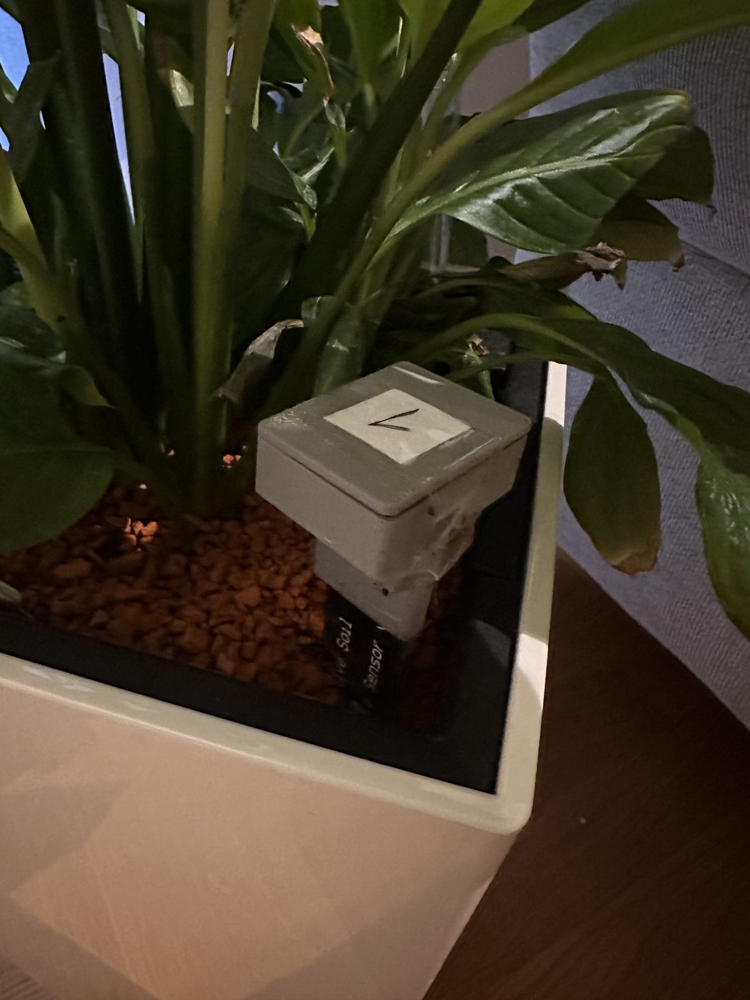
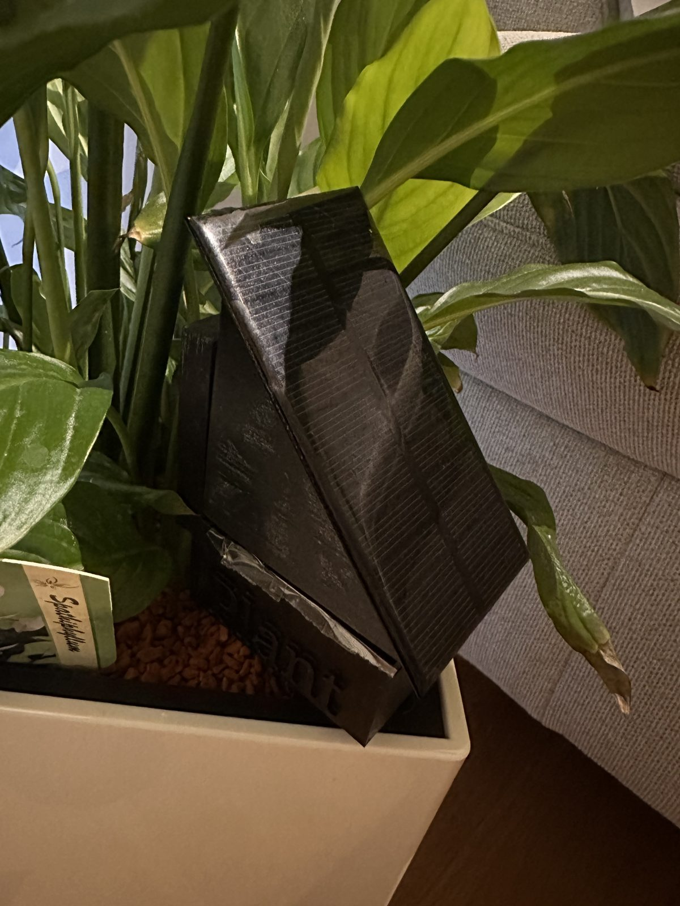
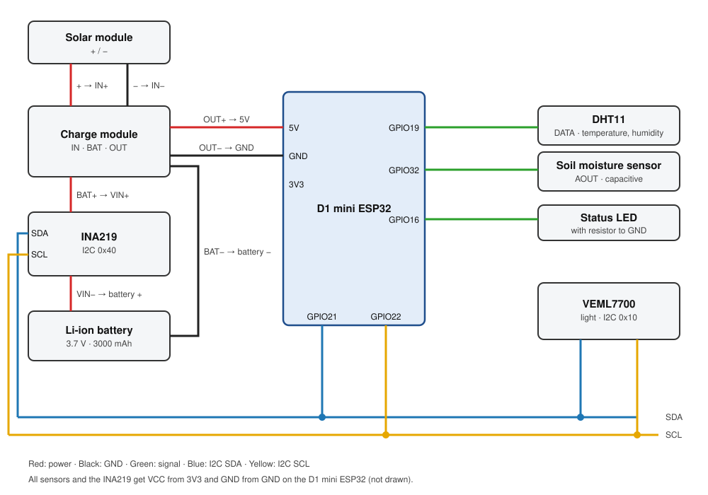

# Moisture Sensor

- A self-built soil moisture sensor for plants
- Two versions: cable and solar
- ESPHome and Home Assistant
- 3D printed case

<div align="center">



</div>

## Moisture Sensor

So far there are two versions:

| Version | Board | Power | Notes |
|---|---|---|---|
| [1](#version-1-d1-mini-in-a-3d-printed-case) | Wemos D1 mini (ESP8266) | USB cable | For cable operation. 3D printed case ([Cults3D](https://cults3d.com/:127333)) |
| [2](#version-2-d1-mini-esp32-with-3000-mah-battery-and-solar-module) | D1 mini ESP32 | 3000 mAh battery, solar module | For off-grid solar operation outdoors |

I use these sensors for my house plants and in my [self-watering raised bed](https://github.com/dev-dany97/raised-bed-irrigation), where the soil moisture decides whether the pump runs.

### Version 1: D1 mini in a 3D printed case

The first version is made for cable operation. It uses an ESP8266 (Wemos D1 mini) with a capacitive soil moisture sensor, which doesn't corrode in the soil, and is powered over USB. I used the case from [Cults3D](https://cults3d.com/:127333), since I didn't design it myself.


#### Parts

| Part | Notes |
|---|---|
| [Wemos D1 mini (Lite)](https://www.wemos.cc/en/latest/d1/d1_mini_lite.html) | ESP8266, Wi-Fi |
| Capacitive Soil Moisture Sensor v1.2 | Capacitive, so it doesn't corrode in the soil like resistive sensors |
| USB cable and power supply | 5 V |
| 3D printed case | From [Cults3D](https://cults3d.com/:127333) |

#### Wiring

| From | To |
|---|---|
| Soil sensor VCC | 3.3V on the D1 mini |
| Soil sensor GND | GND on the D1 mini |
| Soil sensor AOUT | A0 on the D1 mini |
| USB power supply | USB port on the D1 mini |

#### ESPHome and Home Assistant

Version 1 runs without deep sleep, because it is powered by cable. It reads the soil sensor on A0 every 60 seconds and sends the values over MQTT:

| Topic | Value |
|---|---|
| `pflanzensensor/sensor/bodenfeuchtigkeit/state` | Soil moisture in % |
| `pflanzensensor/sensor/soil_moisture_sensor_voltage/state` | Raw sensor voltage |

Home Assistant picks the values up through its MQTT integration. Calibrate the two values in `calibrate_linear` for your own sensor: the voltage in water is 100 %, the voltage in dry air is 0 %. If Windows doesn't recognise the D1 mini, install the [CH340 driver](https://www.wemos.cc/en/latest/ch340_driver.html).

<details>
<summary>Show <code>plantsensor-v1.yaml</code></summary>

```yaml
esphome:
  name: plantsensor-v1
  friendly_name: Plantsensor_V1
  min_version: 2025.11.0
  name_add_mac_suffix: false

esp8266:
  board: d1_mini

logger:

wifi:
  ssid: !secret wifi_ssid
  password: !secret wifi_password

ota:
  - platform: esphome

captive_portal:

# --------------------
# MQTT
# Topic: pflanzensensor/sensor/bodenfeuchtigkeit/state
# --------------------
mqtt:
  broker: !secret mqtt_broker
  username: !secret mqtt_username
  password: !secret mqtt_password
  topic_prefix: pflanzensensor

# --------------------
# Sensoren
# --------------------
sensor:

  # Bodenfeuchte Spannung (A0)
  # Der D1 mini hat einen Spannungsteiler am A0, daher x 3.3
  - platform: adc
    pin: A0
    name: "Soil Moisture Sensor Voltage"
    id: soil_moisture_voltage
    unit_of_measurement: "V"
    accuracy_decimals: 3
    update_interval: 60s
    filters:
      - multiply: 3.3

  # Bodenfeuchte %
  # Kalibrierung: Wert im Wasser -> 100, Wert in trockener Luft -> 0
  - platform: template
    name: "Bodenfeuchtigkeit"
    unit_of_measurement: "%"
    device_class: moisture
    accuracy_decimals: 0
    lambda: |-
      return id(soil_moisture_voltage).state;
    update_interval: 60s
    filters:
      - calibrate_linear:
          - 1.29 -> 100
          - 2.80 -> 0
      - lambda: |-
          if (x > 100) return 100;
          if (x < 0) return 0;
          return x;
```

</details>

### Version 2: D1 mini ESP32 with 3000 mAh battery and solar module



The second version is made for off-grid solar operation outdoors. It uses a D1 mini ESP32, together with a 3000 mAh battery that is charged by a solar module. The matching case is in `3d-models/stl/` (`_v2` and `_v3` files).

Besides soil moisture it measures temperature and humidity (DHT11) and light (VEML7700). An INA219 also measures the battery voltage and current, so I can see how well the solar module keeps up and whether it gets enough sunlight. If there isn't enough sunlight, I can also increase the sending interval to save more energy.

#### Wiring diagram



#### ESPHome and Home Assistant

| Pin | Connected to |
|---|---|
| GPIO21 / GPIO22 | I2C SDA / SCL (INA219 at `0x40`, VEML7700 at `0x10`) |
| GPIO19 | DHT11 |
| GPIO32 | Soil sensor AOUT |
| GPIO16 | Status LED |

How the config works:

- After booting, the sensor waits 60 seconds so the battery voltage is stable before it measures.
- Soil moisture is read as a voltage on GPIO32 and converted to percent: 1.29 V is 100 % (wet), 2.80 V is 0 % (dry). Calibrate these two values for your own sensor.
- The battery voltage comes from the INA219. The battery level in percent is calculated from it (4.20 V is 100 %, 3.50 V is 0 %), and a text sensor shows the status as `voll`, `ok`, `niedrig` or `kritisch`.
- The sensor is awake for 90 seconds and then goes into deep sleep for 4 hours.

| Entity | Value |
|---|---|
| Soil Moisture, Soil Moisture Sensor Voltage | Soil moisture in % and the raw voltage |
| Plant Temperature, Plant Humidity | DHT11 |
| Plant Ambient Light, Plant Full Spectrum, Plant Infrared | VEML7700 |
| Battery Voltage, Battery Level, Battery Status | Battery |
| Battery Current, Battery Power, Battery Shunt Voltage | INA219 |

The sensor connects to Home Assistant through the ESPHome native API, so Home Assistant finds it automatically.

<details>
<summary>Show <code>plantsensor-v2-solar.yaml</code></summary>

```yaml
esphome:
  name: plantsensor-solar-1
  friendly_name: Plantsensor_Solar_1
  min_version: 2025.11.0
  name_add_mac_suffix: false

  on_boot:
    priority: -100
    then:
      - logger.log: "Warte auf stabile Batteriespannung..."
      - delay: 60s

esp32:
  board: esp32dev
  framework:
    type: arduino

logger:

wifi:
  ssid: !secret wifi_ssid
  password: !secret wifi_password
  power_save_mode: HIGH
  fast_connect: true

api:

ota:
  - platform: esphome

time:
  - platform: sntp
    id: sntp_time
    timezone: Europe/Berlin
    servers:
      - 0.pool.ntp.org
      - 1.pool.ntp.org
      - 2.pool.ntp.org

captive_portal:

web_server:
  port: 80

# --------------------
# Status LED
# --------------------
output:
  - platform: gpio
    pin: GPIO16
    id: led_output

# --------------------
# I2C: INA219 + VEML7700
# SDA = D21 / GPIO21
# SCL = D22 / GPIO22
# --------------------
i2c:
  sda: GPIO21
  scl: GPIO22
  scan: true

# --------------------
# Sensoren
# --------------------
sensor:

  # DHT11
  # GPIO22 ist jetzt I2C-SCL, daher DHT11 auf GPIO19
  - platform: dht
    pin: GPIO19
    model: DHT11
    temperature:
      name: "Plant Temperature"
    humidity:
      name: "Plant Humidity"
    update_interval: 15s

  # Licht VEML7700
  - platform: veml7700
    address: 0x10
    update_interval: 30s

    ambient_light:
      name: "Plant Ambient Light"

    full_spectrum:
      name: "Plant Full Spectrum"

    infrared:
      name: "Plant Infrared"

  # Bodenfeuchte Spannung
  - platform: adc
    pin: GPIO32
    name: "Soil Moisture Sensor Voltage"
    id: soil_moisture_voltage
    unit_of_measurement: "V"
    attenuation: 12db
    accuracy_decimals: 3
    update_interval: 10s

  # Bodenfeuchte %
  - platform: template
    name: "Soil Moisture"
    unit_of_measurement: "%"
    device_class: moisture
    accuracy_decimals: 0
    lambda: |-
      return id(soil_moisture_voltage).state;
    update_interval: 10s
    filters:
      - calibrate_linear:
          - 1.29 -> 100
          - 2.80 -> 0
      - lambda: |-
          if (x > 100) return 100;
          if (x < 0) return 0;
          return x;

  # INA219 Batterie
  - platform: ina219
    address: 0x40
    shunt_resistance: 0.1 ohm
    max_voltage: 32.0V
    max_current: 3.2A
    update_interval: 10s

    bus_voltage:
      name: "Battery Voltage"
      id: battery_voltage
      accuracy_decimals: 2

    current:
      name: "Battery Current"
      accuracy_decimals: 3

    power:
      name: "Battery Power"
      accuracy_decimals: 3

    shunt_voltage:
      name: "Battery Shunt Voltage"
      accuracy_decimals: 3

  # Batteriestand %
  - platform: template
    name: "Battery Level"
    unit_of_measurement: "%"
    device_class: battery
    accuracy_decimals: 0
    lambda: |-
      return id(battery_voltage).state;
    filters:
      - calibrate_linear:
          - 4.20 -> 100
          - 4.15 -> 95
          - 4.11 -> 90
          - 4.08 -> 85
          - 4.02 -> 80
          - 3.98 -> 75
          - 3.95 -> 70
          - 3.91 -> 65
          - 3.87 -> 60
          - 3.85 -> 55
          - 3.84 -> 50
          - 3.82 -> 45
          - 3.80 -> 40
          - 3.79 -> 35
          - 3.77 -> 30
          - 3.75 -> 25
          - 3.73 -> 20
          - 3.71 -> 15
          - 3.69 -> 10
          - 3.61 -> 5
          - 3.50 -> 0
      - lambda: |-
          if (x > 100) return 100;
          if (x < 0) return 0;
          return x;

# --------------------
# Batterie Status
# --------------------
text_sensor:
  - platform: template
    name: "Battery Status"
    lambda: |-
      float v = id(battery_voltage).state;

      if (v >= 3.95) return {"voll"};
      else if (v >= 3.80) return {"ok"};
      else if (v >= 3.70) return {"niedrig"};
      else return {"kritisch"};

# --------------------
# Deep Sleep
# --------------------
deep_sleep:
  run_duration: 90s
  sleep_duration: 240min
```

</details>

## License

[MIT](LICENSE)

Thanks to the maker and ESPHome community for the inspiration.
